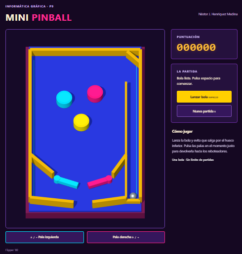

# INFORMÁTICA GRÁFICA · Práctica 9 · Mini Pinball

**Autor:** [Néstor J. Henríquez Medina](https://github.com/NestorJHM).

Simulación de una máquina de pinball construida con **three.js**, **Ammo.js** y **tween.js**. El jugador controla dos palas para mantener una bola en juego y golpear tres reboteadores que dan puntos.



_Figura 1. Máquina pinball. Flipper '80_

## Vídeo de demostración

### [Enlace al vídeo demo en YouTube](https://youtube.com/shorts/MRDm9U1PMEA)

## Tabla de contenido

1. [Descripción del proyecto](#descripción-del-proyecto)
2. [Ejecución](#ejecución)
3. [Controles y reglas](#controles-y-reglas)
4. [Física con Ammo.js](#física-con-ammojs)
5. [Animaciones con tween.js](#animaciones-con-tweenjs)
6. [Organización del código](#organización-del-código)
7. [Alcance y limitaciones](#alcance-y-limitaciones)
8. [Fuentes y referencias bibliográficas](#fuentes-y-referencias-bibliográficas)
9. [Asistencia de IA](#asistencia-de-ia)

## Descripción del proyecto

Esta práctica consiste en una mesa de pinball con cámara fija, un canal lateral de lanzamiento, una bola, dos palas inferiores y tres reboteadores de colores. Las paredes delimitan el tablero. En la parte inferior queda un hueco por el que se pierde la bola y se vuelve a comenzar lanzándola con la barra espaciadora por el canal de lanzamiento inicial.

Los reboteadores aportan un impulso adicional al recibir un golpe y suman puntos. Las palas se accionan de forma independiente.

La paleta visual se inspira en las recreativas de los años 80: tablero azul eléctrico, bordes amarillos, carcasa fucsia oscura y elementos de juego en cian, fucsia y amarillo. El marcador utiliza un tono ámbar y los botones mantienen los colores de las palas.

## Ejecución

La simulación utiliza **HTML, CSS y JavaScript**, con las bibliotecas incluidas en `lib/`. No se necesita instalar nada más.

Para probarla, abrir la carpeta con **Live Server** en Visual Studio Code o con servidor HTTP. Por ejemplo, si se dispone de Python 3:

```bash
python -m http.server 8000 --bind 127.0.0.1
```

Ejecutar el comando desde la carpeta del proyecto y abrir [http://127.0.0.1:8000/](http://127.0.0.1:8000/). Python solo sirve los archivos; el juego se ejecuta íntegramente en el navegador. Para detener el servidor, pulsar Ctrl+C en la terminal.

Se recomienda un navegador con WebGL 2, como Brave o Chrome. No debe abrirse `index.html` con doble clic: los módulos de JavaScript necesitan cargarse a través de HTTP.

## Controles y reglas

| Acción | Teclado | Interfaz |
|---|---|---|
| Mover la pala izquierda | Mantener **A** o **←** | Mantener pulsado «Pala izquierda» |
| Mover la pala derecha | Mantener **D** o **→** | Mantener pulsado «Pala derecha» |
| Lanzar una bola | **Espacio** | «Lanzar bola» |
| Reiniciar la partida y la puntuación | **R** | «Nueva partida» |

- Al empezar, la bola espera en el fondo del canal derecho, junto al tope inferior.
- Se puede lanzar cuando no hay una bola en juego o cuando la bola regresa al fondo del canal lateral.
- Cada golpe contra un reboteador suma **100 puntos**.
- Se aplica una espera de 250 ms por reboteador para evitar sumar en cada fotograma del mismo contacto.
- Cuando la bola supera la salida inferior, se oculta y se puede volver a lanzar. La puntuación se conserva.
- «Nueva partida» devuelve la bola al canal y pone el marcador a cero.
- No hay un número limitado de vidas.

Los botones de las palas también admiten pulsación mediante ratón o pantalla táctil. Al cambiar de pestaña o perder el foco se liberan los controles para evitar que una pala quede pulsada.

## Física con Ammo.js

### Mundo físico y cuerpos rígidos

Se crea un `btDiscreteDynamicsWorld` con su configuración de colisiones, dispatcher, broadphase y solver, siguiendo la estructura del ejemplo de la asignatura `script_45_ammo.js` [2].

Cada objeto físico tiene una malla de three.js y un cuerpo de Ammo asociado en `mesh.userData.physicsBody`:

- **Bola:** `btSphereShape`, con masa de 0,7.
- **Palas:** `btBoxShape`, con masa de 2.
- **Reboteadores y anclajes de las palas:** `btCylinderShape`, sin masa.
- **Suelo, paredes y guías:** cajas estáticas, con masa cero.

En cada fotograma, `stepSimulation` avanza la física y `updatePhysics` copia la posición y el cuaternión de los cuerpos dinámicos a las mallas.

### Simplificación del tablero

La superficie se mantiene horizontal en las coordenadas de la escena. La gravedad es `(0, -9.8, 7.0)`: la componente Z empuja la bola hacia el jugador, representando la pendiente de la mesa (7 grados en este caso).

Durante el juego, la bola tiene un factor de movimiento lineal `(1, 0, 1)`, que mantiene fija su altura; la bola no puede saltar fuera de la mesa. Mientras espera el lanzamiento se bloquea también su desplazamiento en X y Z.

### Articulaciones de las palas

Cada pala se une a un anclaje estático mediante una `btHingeConstraint`, con eje vertical. La articulación restringe el movimiento a un giro y establece límites de apertura.

Mientras se mantiene una tecla, un motor angular mueve la pala hacia su posición elevada. Al soltarla, el motor invierte su sentido para llevarla al reposo. La bola recibe el golpe por la colisión con la pala, sin asignarle una trayectoria prefijada.

### Rebotes y estabilidad

Se consultan los contactos del dispatcher para detectar golpes de la bola contra los reboteadores. Sus identificadores permiten distinguirlos del suelo y de las paredes. Tras un contacto válido se suma la puntuación y se aplica un impulso horizontal dirigido desde el reboteador hacia la bola.

La bola tiene activada la detección continua de colisiones (CCD) para reducir la posibilidad de atravesar paredes finas a gran velocidad.

El reinicio reutiliza la bola y sus cuerpos físicos: restablece su transformación, velocidad y fuerzas, en lugar de crear una nueva simulación en cada partida.

## Animaciones con tween.js

tween.js se utiliza para dos animaciones visuales:

1. **Entrada de cámara:** un acercamiento breve al cargar la aplicación, con interpolación `Quadratic.Out`.
2. **Destello de los reboteadores:** el aro superior aumenta de tamaño y vuelve al original mediante `repeat(1)` y `yoyo(true)` después de un impacto.

La posición de la bola y el movimiento de las palas dependen de Ammo.

## Organización del código

| Archivo | Contenido |
|---|---|
| `index.html` | Contenedor de la escena, marcador, mensajes y botones |
| `style.css` | Distribución de la página y adaptación a pantallas pequeñas |
| `script.js` | Escena, cuerpos físicos, articulaciones, entrada, puntuación y animación |
| `lib/` | Bibliotecas locales de three.js, tween.js y Ammo.js, con sus licencias |
| `README.md` | Explicación del proyecto y referencias |


## Alcance y limitaciones

Es un prototipo de pinball. La física está simplificada.

- Una mesa y una bola, sin rampas, multibola ni mecanismos de bloqueo.
- Cámara fija después de la animación inicial.
- Los reboteadores añaden un impulso de juego al rebote físico.
- El comportamiento puede variar ligeramente según la frecuencia de actualización y los contactos físicos.

## Fuentes y referencias bibliográficas

1. **Material docente de Informática Gráfica.** [Sesión 11: Animación y enunciado de la tarea](https://github.com/otsedom/otsedom.github.io/blob/main/IG/S11/README.md). Requisitos de la práctica y explicación de tween.js, Ammo.js y estructuras articuladas.
2. **Material docente de Informática Gráfica.** [script_45_ammo.js](https://github.com/otsedom/otsedom.github.io/blob/main/IG/S11/code/script_45_ammo.js). Base de referencia para organizar el mundo físico, crear cuerpos rígidos y sincronizarlos con las mallas.
3. **Material docente de Informática Gráfica.** [script_41_tween.js](https://github.com/otsedom/otsedom.github.io/blob/main/IG/S11/code/script_41_tween.js) y [galería de código de la sesión](https://github.com/otsedom/otsedom.github.io/tree/main/IG/S11/code). Referencia de estilo y uso de animaciones interpoladas.
4. **three.js contributors.** [Documentación de three.js](https://threejs.org/docs/) y [guía de instalación](https://threejs.org/manual/pages/installation.html). Geometrías, materiales, cámara, luces y carga en el navegador.
5. **Ammo.js contributors.** [Repositorio de Ammo.js](https://github.com/kripken/ammo.js) y [definiciones de su API](https://github.com/kripken/ammo.js/blob/main/ammo.idl). Cuerpos rígidos, restricciones de bisagra, motores angulares y detección continua de colisiones.
6. **Alexander Gräfenstein y colaboradores.** [ammojs-typed](https://github.com/giniedp/ammojs-typed). Distribución de Ammo utilizada por este proyecto.
7. **tween.js contributors.** [Guía de tween.js](https://tweenjs.github.io/tween.js/docs/user_guide.html). Grupos, interpolaciones, repeticiones y animaciones de ida y vuelta.


## Asistencia de IA

Se ha utilizado **ChatGPT/Codex** para revisar el código, dar estilos (styles.css) y redactar este README.
